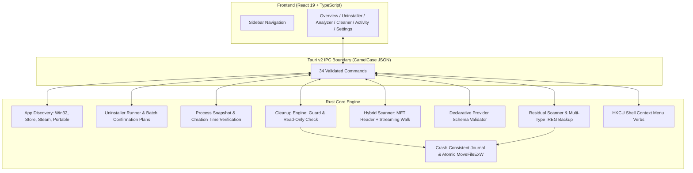

# Cyron

Cyron is a Windows desktop utility that unifies application uninstallation, disk-space analysis,
duplicate detection, and developer/AI cache cleaning. It provides a modern, review-first alternative to
Revo Uninstaller, WinDirStat/WizTree, BleachBit, and Bulk Crap Uninstaller (BCUninstaller) with plain-language
risk labels, built for everyday users and developers alike.

> **Review-first safety & durable recovery.** Cyron measures files and caches, displays every single file and
> registry subkey it plans to touch, and executes modifications only after an explicit confirmation.
> Protected data — conversation histories, AI model weights, configurations, credentials, Docker/WSL virtual disks,
> and browser profiles — is enforced and refused by the Rust backend. Cleaning is off by default: Cyron starts
> in read-only mode until you deliberately enable it. Uninstallation verifies commands server-side, validates
> process snapshot creation times to prevent PID recycling races, unconditionally protects Windows critical processes,
> backs up registry subkeys into multi-type `.reg` files before deletion, and moves residuals to quarantine.

---

## What Works in Cyron

### 1. Application Inventory & Uninstallation
- **Multi-Source Discovery**:
  - **Win32 Applications**: Reads 64-bit and 32-bit views across `HKEY_LOCAL_MACHINE` and `HKEY_CURRENT_USER`, filtering system components and updates. Identifies missing/broken uninstallers when executables no longer exist on disk.
  - **Microsoft Store / MSIX / AppX**: Discovers installed modern packages via `AppModel\Repository\Packages` with read-only inventory and direct file inspection.
  - **Steam Game Libraries**: Auto-detects Steam libraries across drives (`libraryfolders.vdf`), parsing `appmanifest_*.acf` to report game names, exact disk sizes, and launch URLs (`steam://uninstall/<appid>`).
  - **Portable Applications**: Bounded heuristic scanning in user app directories (`%LOCALAPPDATA%\Programs`) identifying standalone PE binaries without uninstaller registration.
- **Standard & MSI Uninstallation**: Validates vendor uninstall commands and Windows Installer GUIDs, rejecting dangerous shell interpreters (`cmd.exe`, `powershell.exe`). Tracks process exit codes and handles reboot-required code `3010`.
- **Process Manager**: Discovers running processes associated with the application's installation folder, verifies process creation times against snapshots to prevent PID recycling races, and unconditionally protects Windows critical system processes.
- **Leftover Scanner**: Detects residual files, directories, and registry keys under AppData, ProgramData, and Windows Registry. Automatically creates a complete recursive `.reg` backup preserving all 6 Windows value types (`REG_SZ`, `REG_DWORD`, `REG_QWORD`, `REG_BINARY`, `REG_EXPAND_SZ`, `REG_MULTI_SZ`) before subkey deletion, and moves residual files to quarantine.
- **Sequential Batch Uninstallation**: Review-first batch queue executing under server-held, 10-minute expiring single-use confirmation plans (`BatchUninstallPlan`) with failure isolation.

### 2. Disk Space Analyzer
- **Squarified Treemap**: High-performance canvas-based hierarchical visualizer with zoom, breadcrumbs, and color-coded categories.
- **Persistent Synchronized Tree**: Resizable virtualized folder tree (220–520 px) with ARIA keyboard navigation, synchronized selection, and drill-down.
- **Storage Intelligence**: Classifies disk occupancy into 10 categories (Applications, Games, Downloads, Documents, Media, System, Developer Tools, AI Models, Caches, Other) with known-vs-inferred confidence.
- **Duplicate Scanner**: Size grouping, 4 KiB edge hashing, and streaming SHA-256 verification. Hard links are identified and excluded from recoverable space.
- **Dual Engine**: High-speed NTFS Master File Table (MFT) parser for whole drives (10× faster than walk) with automatic fallback to streaming directory walking on subfolders or non-elevated shells.
- **Direct Cleaner Review**: Selecting a recognized cache folder in the treemap or folder tree surfaces a **Review for Cleanup** action, displaying expected reclaimable bytes and launching the review-first workflow.

### 3. Review-First Cache Cleaner & Extensible Providers
- **Declarative Provider System**: Versioned (`schema_version: 1`) provider definitions with strict path validation, risk categorization (**Safe**, **Caution**, **Protected**), and application detection.
- **Developer & AI Cache Catalog**: Covers Claude Code, Codex, Gemini, Cursor, VS Code, Ollama, Hugging Face, npm, pnpm, Yarn, pip, Poetry, uv, Cargo, Rustup, Gradle, vcpkg, Docker, WSL, Windows temp files, and browsers.
- **Enforced Backend Protections**: Protected data (chat logs, models, credentials, settings, Windows Update downloads) is unconditionally rejected from cleaning in the Rust backend.
- **Recoverable Quarantine**: Cleaned files are moved into `<app_data>\quarantine\<run-id>\` alongside an append-only, durable write-ahead recovery journal (`recovery_journal.jsonl` with physical `sync_all`). Restores use atomic `MoveFileExW` no-overwrite guarantees.

### 4. Windows Explorer Context Menu Integration
- **Per-User HKCU Integration**: Optional right-click shell verbs registered under `HKEY_CURRENT_USER\Software\Classes` without requiring administrator privileges:
  - **Standard Verbs**: *Analyze with Cyron*, *Find Duplicates with Cyron*, *View Storage Breakdown with Cyron*, *Uninstall with Cyron*, *Find Related Files with Cyron*.
  - **Advanced & Destructive Verbs**:
    - **Files & Folders**: *Force Delete with Cyron*, *Find Locking Processes with Cyron*.
    - **Executables (`.exe`)**: *Kill Running Process with Cyron*.
- **Review-First Deletion & Termination**: Shell actions never execute silently or delete directly from command-line arguments. Cyron launches directly into focused review modals backed by backend-held, single-use execution plans (`StoredForceDeletePlan`, `StoredKillProcessPlan`).
- **Windows Restart Manager**: Detects active file/folder locking processes via `rstrtmgr.dll`, providing graceful process closure (`WM_CLOSE`) and verified force termination with PID creation-time checks.
- **Recoverable Quarantine Default**: Force Delete routes objects through a 7-day recoverable quarantine batch with write-ahead recovery journals (`recovery_journal.jsonl`); permanent removal requires explicit, separate confirmation.
- **System & Root Refusal**: Refuses Windows, boot, System32, Program Files, user roots, and critical system components.
- **Settings Controls**: Independent toggles for Standard and Advanced/Destructive Explorer integration with 1-click status checking and repair.

### 5. Hunter Mode & Desktop Window Targeting
- **Main Sidebar Placement**: Positioned directly below Uninstaller in the primary sidebar navigation as a global session action.
- **Activation Confirmation**: Clicking Hunter Mode opens a compact confirmation modal explaining external window targeting, available actions, and exit controls before any cursor tracking begins.
- **Session Lifecycle**: Cursor tracking and targeting resolution only run during an active confirmed session; HUD banner and floating crosshair triggers are strictly hidden when inactive.
- **Active Sidebar Indicator**: Persistent active indicator badge in the sidebar with an inline exit control; supports instant `Esc` cancellation without leaving stale targets or background polling.

---

## Architecture & Safety Guarantees



- **Server-Held Confirmation Plans**: Every destructive action (cleaning, uninstallation, process termination, leftover removal, batch uninstallation) requires an expiring, single-use plan generated server-side.
- **Fail-Closed Execution**: If process creation time cannot be verified, or if write-ahead journal synchronization fails, operations abort immediately.
- **Zero In-Place Deletion**: Files are moved into quarantine batches; permanent purging is explicitly separated and manifest-scoped.
- **No Network Telemetry**: Cyron does not contain tracking, analytics, or network-bound phone-home code.

---

## Getting Started

### Prerequisites
- Windows 10 (1809+) or Windows 11 (64-bit).
- **Node.js 22+** and npm.
- **Rust stable (1.77+)** with the `x86_64-pc-windows-msvc` target.
- **Visual Studio 2022 Build Tools** with *Desktop development with C++* workload.
- On standard Developer shells or Git Bash, `scripts/msvc-env.mjs` automatically configures MSVC environment variables (`PATH`, `LIB`, `INCLUDE`).

### Running Locally

```powershell
npm install
npm run dev:desktop        # Vite + Tauri desktop window
```

Build a standalone desktop executable:

```powershell
npm run build:desktop      # src-tauri/target/debug/cyron.exe
```

---

## Verification & Testing

Every build is verified with automated test suites, stress harnesses, and end-to-end fixtures:

```powershell
npm run typecheck                                      # TypeScript type validation (0 errors)
npm test                                               # 71 Vitest frontend tests
npm run build                                          # Production frontend bundle
node scripts/verify-dist.mjs                           # Frontend bundle assertions (DIST_OK)
node scripts/msvc-env.mjs cargo test --manifest-path src-tauri/Cargo.toml
node scripts/msvc-env.mjs cargo test --manifest-path src-tauri/Cargo.toml --test real_system -- --nocapture
node scripts/msvc-env.mjs cargo test --manifest-path src-tauri/Cargo.toml --test security -- --nocapture
node scripts/msvc-env.mjs cargo test --manifest-path src-tauri/Cargo.toml --test cleanup_stress -- --nocapture
node scripts/msvc-env.mjs cargo test --manifest-path src-tauri/Cargo.toml --test stress_scan -- --nocapture
node scripts/verify-cleanup.mjs                        # Isolated cleanup fixture: CLEANUP_FIXTURE_OK
node scripts/verify-e2e.mjs                            # Complete RC1 E2E fixture: RC1_E2E_FIXTURE_OK
node scripts/verify-desktop-binary.mjs                 # Desktop binary validation: DESKTOP_BINARY_OK
node scripts/smoke-desktop.mjs                         # Desktop window launch test: DESKTOP_SMOKE_OK
node scripts/benchmark-competitive.mjs                 # Competitive scanner benchmark: BENCHMARK_OK
node scripts/verify-release-bundles.mjs                # Release bundles check: RELEASE_BUNDLES_OK
npm run verify:metadata                                # Windows PE & MSI metadata audit: WINDOWS_METADATA_OK
npm run verify:signatures                              # Authenticode signature & negative checks: SIGNATURES_VERIFIED_OK
```

---

## Current Status & Limitations

- **Store / MSIX Uninstallation**: Microsoft Store packages are inventoried with read-only inspection. Because Store lifecycle is managed by Windows Package Manager, standard Win32 uninstallation is disabled with explicit guidance to use Windows Settings or `winget`.
- **Portable Applications**: Discovered via explainable heuristics; standard uninstaller commands are disabled because portable apps lack registry uninstallers. Leftover and disk analysis are available.
- **Code Signing Architecture**: Official Authenticode code signing under the Chryypt Organization:
  - `CHRYYPT_SIGNED`: Releases and installers signed by Chryypt Organization (`CN=Chryypt Organization`, RSA 3072, SHA-256) via `npm run build:signed` (`scripts/sign-build.ps1`).
  - Unsigned builds remain clearly labeled `UNSIGNED_RC` for private testing. Real SmartScreen reputation builds progressively with download volume and user trust.

---

## Documentation Map

- [ROADMAP.md](ROADMAP.md): Project phases, completed milestones, and future work.
- [HANDOFF.md](HANDOFF.md): Engineering state, verified commit history, and immediate priorities.
- [GATES.md](GATES.md): Verifiable acceptance criteria and test evidence.
- [AGENTS.md](AGENTS.md): Architectural contracts, IPC rules, and developer guidelines.
- [docs/ARCHITECTURE.md](docs/ARCHITECTURE.md): Component interactions, IPC contract, and data flows.
- [docs/IMPLEMENTATION_STATUS.md](docs/IMPLEMENTATION_STATUS.md): Detailed verification ledger and test counts.
- [docs/SECURITY.md](docs/SECURITY.md): Threat model, security boundaries, and confirmation plan safety.
- [docs/USER_GUIDE.md](docs/USER_GUIDE.md): End-user walkthrough of Explorer integration, scanning, cleaning, and uninstallation.
- [docs/BENCHMARKS.md](docs/BENCHMARKS.md): Measured performance, working set, and architectural comparison against WinDirStat/WizTree.
- [docs/RELEASE_CHECKLIST.md](docs/RELEASE_CHECKLIST.md): Release packaging and VM verification steps.
- [docs/BUILD_AND_SIGNING.md](docs/BUILD_AND_SIGNING.md): Build instructions, installer targets, WebView2 requirements, and code signing architecture.
- [CONTRIBUTING.md](CONTRIBUTING.md): Code standards, safety invariants, and contribution workflow.

---

## Contributors

- **Ry0x7** — Project Creator, Systems Architecture & Core Engineering
- **Gemini** — Contributor (Advanced Agentic Systems & Implementation)
- **Claude Code** — Contributor (Systems Hardening & Feature Development)
- **Codex** — Contributor (Code Intelligence & Implementation)

---

## License & Git Workflow Policy

- **Source-Available / No-Reuse License**: Cyron Uninstaller is source-available for viewing, security auditing, and personal compilation under the [Cyron Source-Available License](LICENSE). **Code reuse, redistribution, or extraction into any other project or commercial product is strictly prohibited** without prior written permission from the author (Ry0x7).
- **Strict No-Rebase Policy**: Rebasing (`git rebase`) is permanently prohibited across all shared branches and pull requests to preserve immutable cryptographic release provenance, Authenticode signatures, and audit trails. GitHub enforces `allow_rebase_merge: false` and branch protection disallowing force-pushes (`allow_force_pushes: false`). Local clones enforce this via the repository's `pre-rebase` hook (`scripts/setup-git-hooks.ps1`). Integration must always use merge commits (`git merge --no-ff`) or squash merges.
