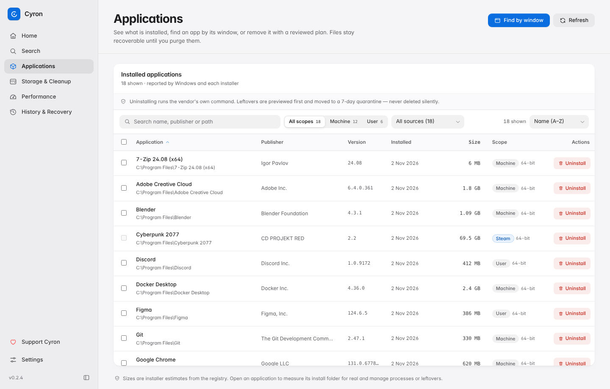
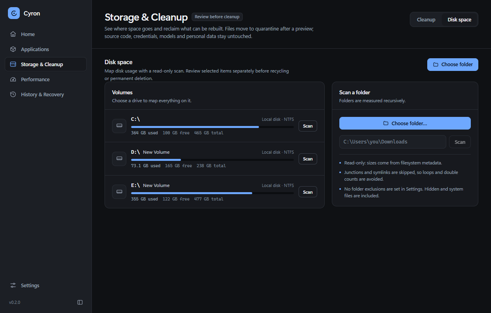
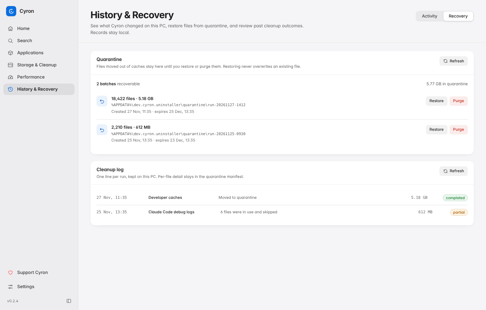

# Cyron Uninstaller

Cyron is a Windows desktop app for uninstalling software, finding what takes up disk space, and reviewing caches and leftover files before you remove them.

## Download for Windows

**[Download Cyron 0.2.1 for Windows](https://github.com/Ry0x7/cyron-uninstaller/releases/tag/v0.2.1)**

Cyron 0.2.1 is the current stable release. The Windows binaries are unsigned. Choose the `x64-setup.exe` asset for a per-user install and verify it against the release's `SHA256SUMS.txt`. Windows may show an unknown-publisher warning. [Release notes](docs/RELEASE_NOTES_v0.2.1.md)

Cyron targets Windows 10 (1809 or later) and Windows 11 on x64 and uses the Microsoft Edge WebView2 Runtime.

## What you can do

These screenshots show the published 0.2.0-rc.2 desktop app.

### Find and uninstall applications

Search installed Windows apps, current-user Store packages, Steam games and detected portable apps. Use **Find by window** if you know the window but need to identify the app. For supported apps, review the uninstall action and then check any leftover files or registry entries separately.

*Applications shows each app's publisher, reported size, install scope and available actions.*

### Find what is using disk space

Open **Storage & Cleanup → Disk space** and scan a drive or folder. Browse the results in a treemap and folder tree, or look for duplicate files. The Cleanup tab measures caches and rebuildable project files so you can review what removal would affect.

*Disk space starts with a read-only scan of the drive or folder you choose.*

### Review cleanup and recover files

Cache cleaning starts in read-only mode. After you enable it, review the selected items and confirm the run. Supported cleanup operations move files to quarantine. Open **History & Recovery → Recovery** to review quarantine and restore available files without overwriting existing ones. A vendor uninstall runs separately from leftover cleanup.

*Recovery shows quarantined items and the local cleanup log. Local paths are redacted.*

The **Performance** page shows local CPU, memory, disk and startup measurements. Version 0.2.0 adds short spike capture and kernel and driver evidence. Elevated tracing and some real-world uninstall paths still have open verification items. [Release audit](docs/RELEASE_AUDIT_2026-11-17.md)

## Documentation

- [User guide](docs/USER_GUIDE.md) for walkthroughs, including Explorer integration.
- [Contributing](CONTRIBUTING.md) and [Build and signing](docs/BUILD_AND_SIGNING.md) for development and packaging.
- [Architecture](docs/ARCHITECTURE.md), [Security](docs/SECURITY.md) and [Desktop design](docs/DESIGN.md) for implementation details.
- [Roadmap](ROADMAP.md), [Engineering handoff](HANDOFF.md) and [Verification gates](GATES.md) for project status.
- [Release checklist](docs/RELEASE_CHECKLIST.md) and [Evidence index](docs/evidence/README.md) for verification records.

## License

Cyron is source-available. Viewing, auditing and personal compilation are governed by the [Cyron Source-Available License](LICENSE). Code reuse and redistribution require written permission from the author.
