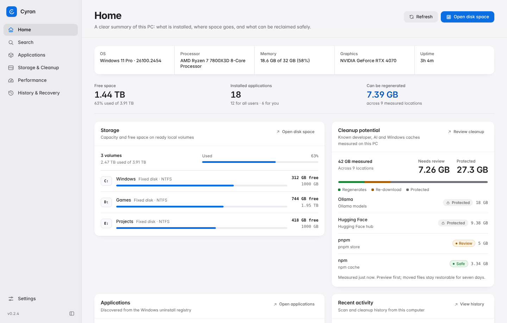
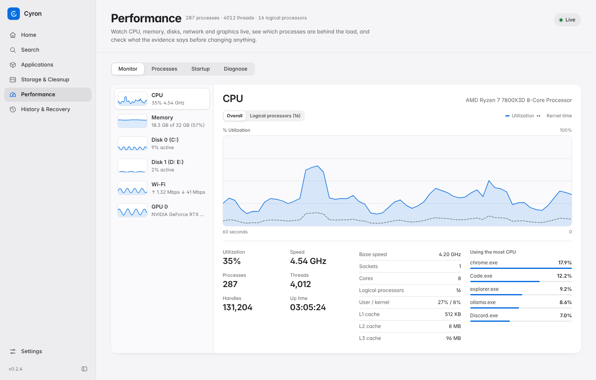
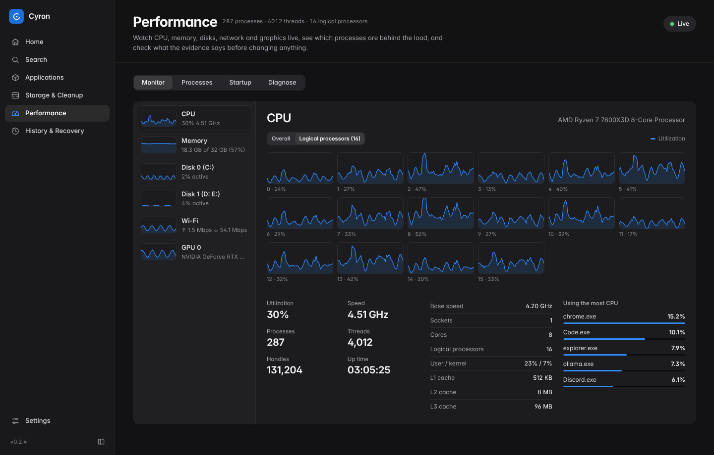
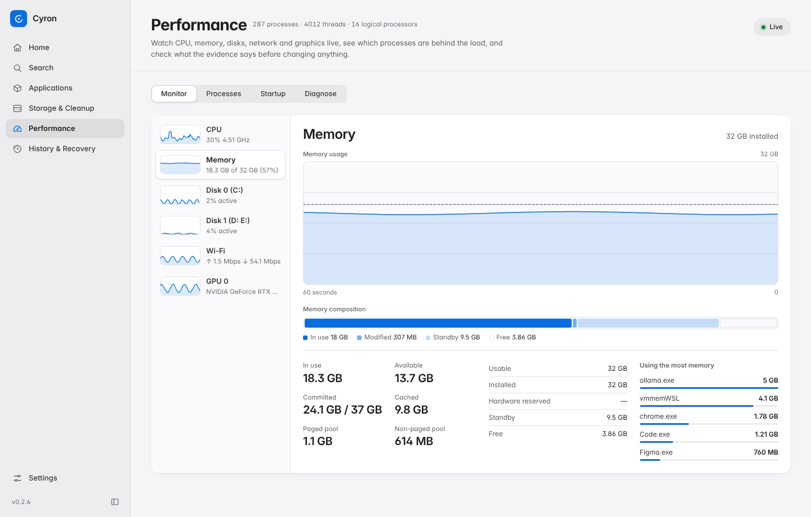
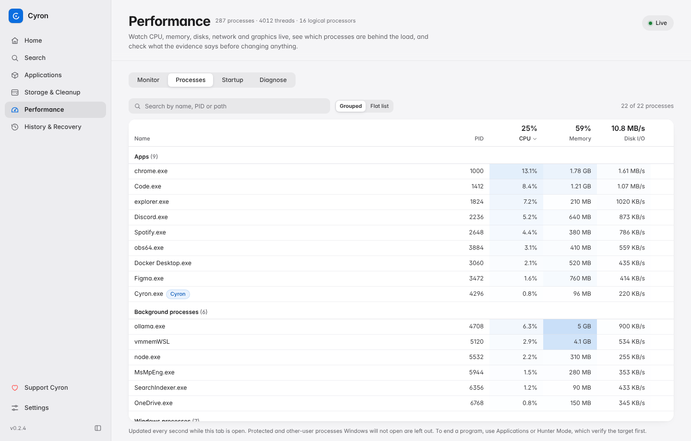
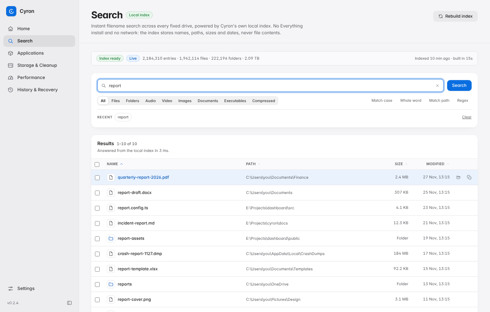
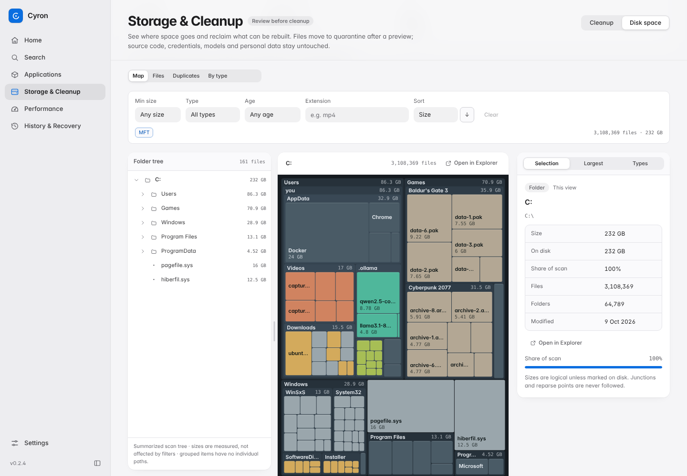
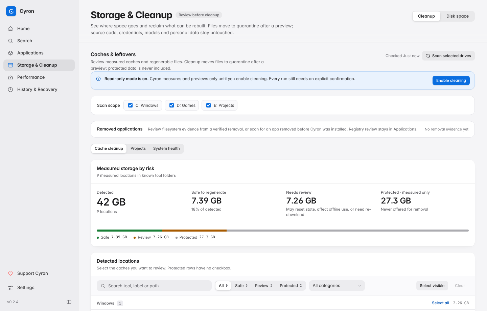
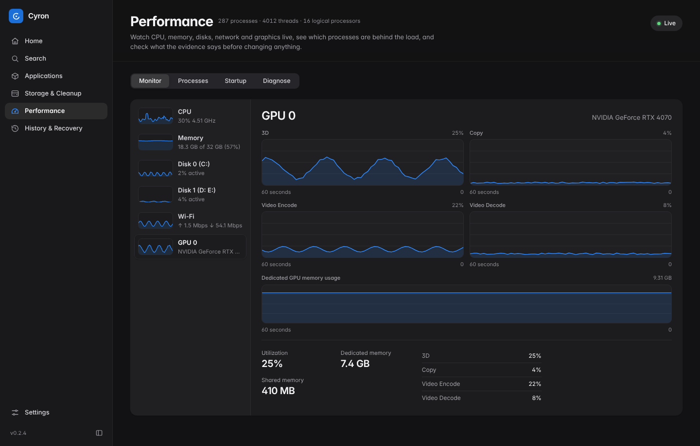

# Cyron Uninstaller

Cyron is a Windows desktop app for uninstalling software, finding what takes up disk space, and reviewing caches and leftover files before you remove them.

## Download for Windows

**[Download Cyron 0.2.4 for Windows](https://github.com/Ry0x7/cyron-uninstaller/releases/tag/v0.2.4)**

Cyron 0.2.4 is the current stable release. The Windows binaries are unsigned. Choose the `x64-setup.exe` asset for a per-user install and verify it against the release's `SHA256SUMS.txt`. Windows may show an unknown-publisher warning. [Release notes](docs/RELEASE_NOTES_v0.2.4.md)

Cyron targets Windows 10 (1809 or later) and Windows 11 on x64 and uses the Microsoft Edge WebView2 Runtime.

## What you can do

The screenshots below preview the redesigned interface. They were rendered from the app's frontend in a browser with sample data (`npm run preview:screenshots`), so the names, sizes and processes are illustrative, not from a real PC.

*Home summarizes the PC: hardware, free space on each drive, installed apps and what can be reclaimed.*

### Watch your PC live

Open **Performance → Monitor** for a Task Manager-style view. The resource rail on the left shows live sparklines for CPU, memory, every disk, every network adapter and every GPU. Pick one to see a 60-second chart you can hover, live figures and hardware details. The CPU view can switch to one chart per logical processor, the Memory view adds a composition bar, and the GPU view shows each engine and dedicated memory. Sampling runs once a second, and only while the tab is visible.

| Logical processors (dark) | Memory |
|---|---|
|  |  |

**Performance → Processes** groups every running process into Apps, Background processes and Windows processes. Sort any column, search by name, PID or path, and open a process's file location. Busy cells are tinted so the heaviest process stands out. There is no end-task button here: diagnostics stay read-only. **Startup** and **Diagnose** keep the startup manager, 20-second spike capture, kernel and driver evidence and baselines.

### Find and uninstall applications

Search installed Windows apps, current-user Store packages, Steam games and detected portable apps. Use **Find by window** if you know the window but need to identify the app. For supported apps, review the uninstall action and then check any leftover files or registry entries separately.

### Search every fixed drive instantly

The **Search** destination builds Cyron's own local file index. One pass stores the name, path, size, dates and attributes of every accessible file and folder on your fixed drives, then search answers from memory in milliseconds. No Everything install, service or network is involved, and file contents are never read.

Use Everything-style syntax when a filename alone is not enough: `report ext:pdf`, `size:>1gb`, `dm:thisweek`, `folder: node_modules`, `path:src`, `dupe:` or `regex:^log-\d+`. Type filters, match-case/whole-word/path options and sortable Name, Path, Size and Modified columns are in the page. Check rows with the mouse or Space/Shift+Arrow, then copy their paths or export just those rows as CSV or TXT; the footer exports the whole sorted result set. The index is saved between sessions and stays current with live file-system changes while Cyron runs; **Rebuild index** folds in changes made since the last build. Search and indexing are read-only, export writes only the rows you request to the destination you choose, and Reveal opens the existing validated File Explorer action.

### Find what is using disk space

Open **Storage & Cleanup → Disk space** and scan a drive or folder. The map is a nested treemap up to four levels deep: each folder is drawn as a framed block with a name and size header, so neighbouring folders read as separate blocks, and files are coloured by type. Every top-level folder keeps its own tile, even on a very large drive. When a deep folder was summarized to keep the view responsive, drilling into it or expanding it in the tree loads its contents on demand. The whole map is drawn on one canvas, so hovering and resizing stay smooth on a full-drive scan. You can also browse a sortable file listing, look for duplicate files or group usage by type.

### Review cleanup and recover files

Cache cleaning starts in read-only mode. The Cleanup tab measures developer, AI and Windows caches and splits them into safe to regenerate, needs review and protected. After you enable cleaning, review the selected items and confirm the run. Supported cleanup operations move files to quarantine. Open **History & Recovery → Recovery** to review quarantine and restore available files without overwriting existing ones. A vendor uninstall runs separately from leftover cleanup.

| Cleanup | Recovery |
|---|---|
|  |  |

### Clean up dead startup and uninstall entries

Open **Storage & Cleanup → Cleanup → System health** and scan the registry. Cyron lists Run/RunOnce values whose program is gone and uninstall registrations whose uninstaller and install folder are both missing. Windows security entries are protected, and entries that need an elevated session are labelled. Removal requires cleaning to be enabled and an explicit confirmation; Cyron re-checks the live entry, exports a verified `.reg` backup and quarantines the batch so it can be restored.

### Update from inside the app

Version 0.2.2 adds **Settings → About → Software updates**. Cyron checks the signed GitHub Releases feed only when you click **Check for updates**, shows download progress, asks for confirmation, verifies the updater signature and restarts after the Windows installer finishes. It does not poll in the background or send telemetry. Existing 0.2.1 installations need one manual 0.2.2 install before this path is available; later releases can update in place. In-app updates use the per-user NSIS setup; MSI installations update from the release page.

### Works in light and dark

Cyron follows the Windows appearance. The design borrows from Apple's system tools: soft neutral backgrounds, borderless cards, a translucent sticky header, segmented tabs and filled controls. See [Desktop design](docs/DESIGN.md).

Elevated tracing and some real-world uninstall paths still have open verification items. [Release audit](docs/RELEASE_AUDIT_2026-11-17.md)

## Documentation

- [User guide](docs/USER_GUIDE.md) for walkthroughs, including Explorer integration.
- [Contributing](CONTRIBUTING.md) and [Build and signing](docs/BUILD_AND_SIGNING.md) for development and packaging.
- [Architecture](docs/ARCHITECTURE.md), [Security](docs/SECURITY.md) and [Desktop design](docs/DESIGN.md) for implementation details.
- [Project website](landing/index.html) is a standalone page in `landing/`; `npm run landing:check` validates it.
- [Roadmap](ROADMAP.md), [Engineering handoff](HANDOFF.md) and [Verification gates](GATES.md) for project status.
- [Release checklist](docs/RELEASE_CHECKLIST.md) and [Evidence index](docs/evidence/README.md) for verification records.

## License

Cyron is source-available. Viewing, auditing and personal compilation are governed by the [Cyron Source-Available License](LICENSE). Code reuse and redistribution require written permission from the author.
